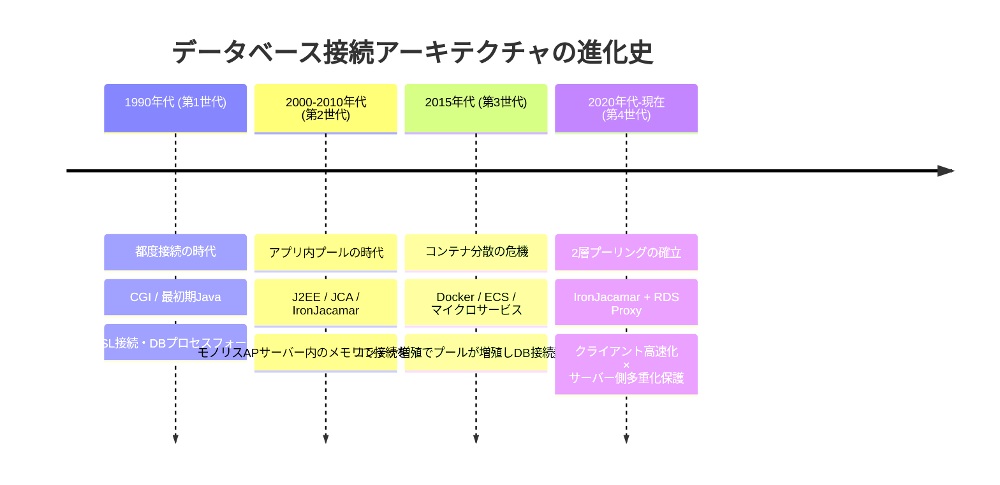
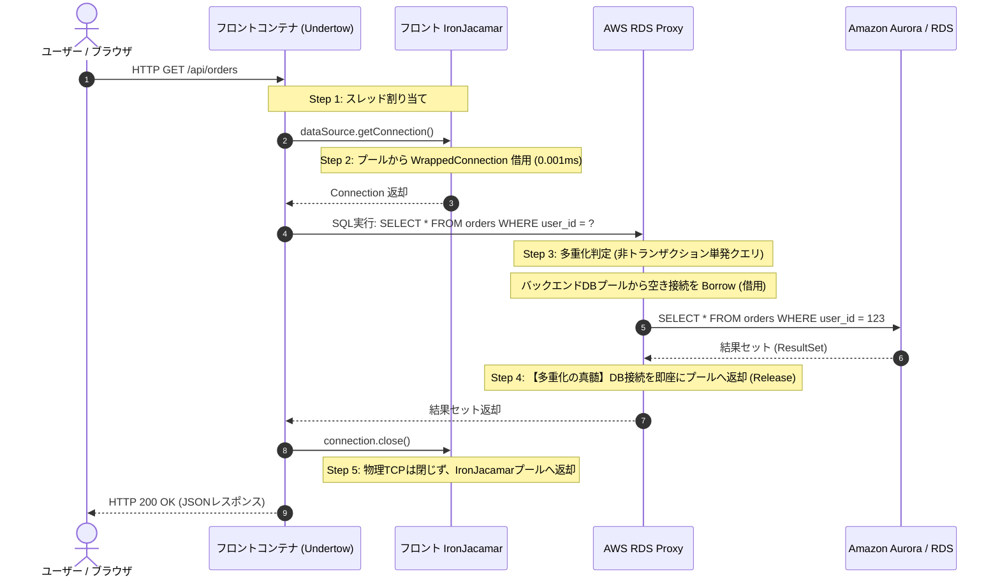

# JBoss EAP 8.1 (IronJacamar) × AWS RDS Proxy コネクションプール完全技術解説

---

## 目次
1. [エグゼクティブサマリー＆小学生でも完全にわかる「学校のたとえ話」](#1-エグゼクティブサマリー小学生でも完全にわかる学校のたとえ話)
2. [登場の歴史と背景：なぜ2つのプールが必要になったのか？](#2-登場の歴史と背景なぜ2つのプールが必要になったのか)
3. [システムアーキテクチャ上の立ち位置（フロント／バック／RDS Proxy）](#3-システムアーキテクチャ上の立ち位置フロントバックrds-proxy)
4. [プーリングしている情報・実体の詳細対比（Javaヒープ vs DBソケット/プロセス）](#4-プーリングしている情報実体の詳細対比javaヒープ-vs-dbソケットプロセス)
5. [動作原理とリクエスト処理シーケンス（Multiplexing と Pinning）](#5-動作原理とリクエスト処理シーケンスmultiplexing-と-pinning)
6. [JBoss EAP 8.1 (IronJacamar) 設定パラメータ完全詳説](#6-jboss-eap-81-ironjacamar-設定パラメータ完全詳説)
7. [AWS RDS Proxy 設定パラメータ完全詳説](#7-aws-rds-proxy-設定パラメータ完全詳説)
8. [2層プール連携設計・キャパシティサイジング計算モデル](#8-2層プール連携設計キャパシティサイジング計算モデル)
9. [現場で頻発する「三大落とし穴」と鉄壁のトラブルシューティング](#9-現場で頻発する三大落とし穴と鉄壁のトラブルシューティング)
10. [設定コード例（standalone.xml / JBoss CLI / Terraform / AWS CLI）](#10-設定コード例standalonexml--jboss-cli--terraform--aws-cli)

---

## 1. エグゼクティブサマリー＆小学生でも完全にわかる「学校のたとえ話」

### 1.1 一言でいうと？
現代の Amazon ECS 上で動作する JBoss EAP 8.1（フロントコンテナ／バックコンテナ）と Amazon RDS / Aurora の間には、**「2重のコネクションプール」** が存在します。
- **IronJacamar（アイアンジャカマー）**: 各コンテナ内部（JVMヒープ）に常駐し、Javaのスレッドに対して「ミリ秒以下の超高速」で接続オブジェクトを貸し出す**クライアント側プール**。
- **RDS Proxy（アールディーエス プロキシ）**: AWSのVPCインフラ層に常駐し、増殖した大量のコンテナから押し寄せる膨大な接続を集約・多重化（Multiplexing）してデータベース本体を守る**サーバー側中間プロキシ**。

```
[クライアント視点]
  ECSタスク内 Javaスレッド
     │ (0.001ms で借用/返却: JVMヒープ内)
     ▼
  IronJacamar (JBoss EAP 8.1)
     │
     │ 物理TCP/TLS接続 (長寿命接続を常時キープ)
     ▼
[インフラ・DB防御視点]
  AWS RDS Proxy (マネージドプロキシ)
     │
     │ 多重化 (Multiplexing: クエリ実行時のみ少数のDB接続を借用)
     ▼
  Amazon RDS / Aurora (PostgreSQL / MySQL)
```

---

### 1.2 小学生でも直感できる「学校のたとえ話」

ITシステムの用語（TCP接続、スレッド、多重化、フェイルオーバー）を、**「学校生活」** に置き換えてみましょう。

| キャラクター | 現実世界のたとえ | ITシステムの正体 | なにをしている人？（役割） | もしいなかったらどうなる？ |
| :--- | :--- | :--- | :--- | :--- |
| **校長先生** | 学校で一番大事な記録を持つ人 | **データベース本体 (RDS / Aurora)** | 全校生徒のテストの点数や通知表を金庫で守っている人。とても頭が良いけれど、一度に何百人もの生徒から一斉に話しかけられると耳がパンクして倒れてしまいます。 | 生徒たちが一斉に話しかけると校長先生が気絶（CPU 100%、メモリ枯渇）してしまい、学校全体がストップ（システム全停止）してしまいます。 |
| **1年1組<br>(フロント係)** | 学校の玄関でお客さんを迎える教室 | **フロントコンテナ (BFF / Web API)** | 外から学校に来る保護者やお客さん（スマホアプリやPC）を最初に笑顔で迎える教室。お客さんが増えると、自動で1組、2組、3組と教室が増えます（ECSオートスケール）。 | 教室が足りなくなると、玄関にお客さんの大行列ができてしまいます。 |
| **1年2組<br>(バック係)** | 奥の部屋で難しい計算をする教室 | **バックコンテナ (業務ドメイン / バッチ)** | フロント係から「この計算お願い！」と頼まれて、大事なお金の計算や帳簿付けをじっくり行う教室。こちらも忙しくなると自動で教室が増えます。 | 計算係がパンクすると、学校の大事な手続きがすべて止まってしまいます。 |
| **学級委員長<br>(IronJacamar)** | 各教室にある【内線電話メモ】を管理する係 | **JBoss EAP 8.1内のコネクションプール** | 各教室（フロント・バックの各コンテナ）の中に1人ずついます。<br>教室の生徒（処理スレッド）が校長先生に電話したいとき、いちいち校長室まで走って電線を引いて電話機を買いに行く（TCP接続＋認証）のは時間がかかりすぎます！<br>そこで学級委員長があらかじめ「机の上に3本の受話器」をキープしておき、「使いたい人はどうぞ！終わったら受話器を机に戻してね」と貸し出してくれます。 | 生徒が質問するたびに毎回新しい電話線を引くことになり、生徒が疲れ果てて質問がめちゃくちゃ遅くなります（応答遅延）。 |
| **スーパー受付秘書<br>(RDS Proxy)** | 校長室のドアの前で電話を取り次ぐプロ | **AWS RDS Proxy (マネージド中間プロキシ)** | 全校生徒と校長先生の間に立つ、超優秀な受付のお姉さん！<br>もし学校全体で100クラスに増えたら、学級委員長の電話（3本×100クラス＝300本！）が一斉に校長室にかかってきます。校長先生は電話を取るだけで倒れます。<br>そこで受付秘書さんが校長室の前に立ち、300本の電話を全部一人で一旦受け止めます。校長先生とは「秘書専用のたった20本の内線」だけで繋ぎ、生徒Aの短い質問（0.1秒）が終わったら、即座に同じ内線で生徒Bの質問を取り次ぎます（多重化）。<br>さらに校長先生が風邪で副校長先生に交代（フェイルオーバー）しても、秘書さんが裏でサッと繋ぎ替えるので、生徒は誰も気づきません！ | クラスが増えた瞬間に校長室の電話が鳴り止まず、校長先生が即死します。校長先生が交代するときに全クラスの電話がプツンと切れて大パニックになります！ |

---

## 2. 登場の歴史と背景：なぜ2つのプールが必要になったのか？

接続アーキテクチャは、Webシステムの進化に伴って **4つの世代** を経て現在の形に到達しました。



### 第1世代：都度接続（Direct Connect）の悲劇（1990年代）
- **動作**: Webブラウザからリクエストが来るたびに、アプリがデータベースに対して接続をオープンし、SQLを実行して、切断する。
- **問題点**:
  - `TCP 3-way handshake` (SYN, SYN-ACK, ACK)
  - `SSL/TLS ネゴシエーション` (証明書交換、暗号鍵共有)
  - `DB認証ハンドシェイク` (ユーザー名/パスワード照合)
  - `DBサーバー側プロセス生成` (PostgreSQLの fork()、MySQLのスレッド生成)
  - これらすべてに **数十ミリ秒〜数百ミリ秒** を要し、接続確立処理だけでDBサーバーのCPUとメモリが飽和してシステムがクラッシュしました。

### 第2世代：アプリ内コネクションプールと IronJacamar の誕生（2000年代〜2010年代）
- **背景**: 「毎回接続を作るのが無駄なら、サーバー起動時にあらかじめ数十本作ってメモリにキープしておき、使い回せばよい」という発想が定着。
- **JCA (Java Connector Architecture) と IronJacamar**:
  - Sun Microsystems（現Oracle）が Java EE 標準として JCA 仕様を策定。
  - Red Hat / JBoss は、JBoss AS 7 および JBoss EAP 6 に向けて、従来のコネクションマネージャをゼロからフルリライトし、**IronJacamar** プロジェクトを発足。
  - 高度なセマフォキューイング、JTA / XA 分散トランザクションとの密結合、2相コミット（2PC）、フェイルファスト、リーク追跡機構を備えたエンタープライズ最高峰のJCAエンジンが完成。
- **当時の前提**: システムは「数台の巨大な物理サーバー（モノリス）」で稼働していたため、アプリ内プールだけでDB保護が完全に成り立っていました。

### 第3世代：クラウド・コンテナ・マイクロサービス時代の「接続数爆発」（2015年代〜）
- **パラダイムシフト**: モノリスAPサーバーが解体され、Dockerコンテナ、Amazon ECS、Kubernetes、AWS Lambdaが主流に。
- **課題（Connection Explosion）**:
  - 1台の巨大サーバーではなく、小さなコンテナ（フロントコンテナ、バックコンテナ）が数十台〜数百台にオートスケールする。
  - **各コンテナが独立したJVMを持ち、それぞれが独自の IronJacamar プールを持つ**。
  - 例：フロント50台 ＋ バック50台 ＝ 100コンテナ。各コンテナの `max-pool-size=50` だと、**最大5,000本** の物理接続がDBに突撃する。
  - PostgreSQLは「1接続＝1プロセス（メモリ約10MB消費）」のアーキテクチャ。5,000接続で接続メモリだけで50GBを消費し、OSのOOM Killerが発動してDBが瞬死（C10K問題）。

### 第4世代：2層プーリングアーキテクチャの確立（2020年代〜現在）
- **RDS Proxy の登場**:
  - AWSが2020年に一般提供開始したフルマネージド型データベースプロキシ。
  - コンテナ（IronJacamar）とRDSの間に割り込み、クライアントからの接続を集約。
  - **多重化（Multiplexing）**: クライアントから数百〜数千の接続を受けつつ、DB本体への実接続は最適な数十〜数百本に抑え込み、クエリ単位で接続を使い回す。
  - **透過的フェイルオーバー**: Auroraのマスター昇格時、接続をプロキシが引き受け、アプリから見て接続が切断されない（切り替え時間を最大66%短縮）。
- **結論**: アプリケーション層の極小レイテンシ（IronJacamar）と、クラウド層の接続集約・DB保護（RDS Proxy）を組み合わせる **「2層プーリング（Two-Tier Connection Pooling）」** が、現代ECS構成における業界標準ベストプラクティスとなりました。

---

## 3. システムアーキテクチャ上の立ち位置（フロント／バック／RDS Proxy）

ECSタスク内でフロントコンテナとバックコンテナが動作し、RDS Proxyを経由してデータベースにアクセスする典型的なエンタープライズ構成における各コンポーネントの立ち位置を整理します。

```
                    ┌──────────────────────────────────────────────┐
                    │               Amazon ECS Task                │
                    │                                              │
Internet / ALB ───> │  ┌─────────────────┐    ┌─────────────────┐  │
                    │  │ フロントコンテナ │    │ バックコンテナ  │  │
                    │  │ (JBoss EAP 8.1) │    │ (JBoss EAP 8.1) │  │
                    │  │                 │    │                 │  │
                    │  │  IronJacamar    │    │  IronJacamar    │  │
                    │  │  [Pool: 3-10]   │    │  [Pool: 5-15]   │  │
                    │  └────────┬────────┘    └────────┬────────┘  │
                    └───────────┼──────────────────────┼───────────┘
                                │ (TCP Client Conn)    │ (TCP Client Conn)
                                └──────────┬───────────┘
                                           │
                                           ▼ VPC Network
                    ┌──────────────────────────────────────────────┐
                    │         AWS RDS Proxy (Multi-AZ)             │
                    │                                              │
                    │  ・Client Connection Manager (集約)          │
                    │  ・Multiplexing Engine (多重化ルータ)        │
                    │  ・Backend Connection Pool (DB実接続: 80本)  │
                    │  ・Secrets Manager / IAM Auth                │
                    └──────────────────────┬───────────────────────┘
                                           │ (Multiplexed Queries)
                                           ▼
                    ┌──────────────────────────────────────────────┐
                    │        Amazon Aurora / RDS (PostgreSQL/MySQL)│
                    │                                              │
                    │  ・Writer Instance (Primary)                 │
                    │  ・Reader Instance (Replica)                 │
                    └──────────────────────────────────────────────┘
```

### 立ち位置詳細比較表

| 比較項目 | フロントコンテナ内 IronJacamar | バックコンテナ内 IronJacamar | AWS RDS Proxy (中間インフラ層) |
| :--- | :--- | :--- | :--- |
| **実行環境** | フロントコンテナの JVM ヒープ | バックコンテナの JVM ヒープ | AWSマネージド VPCインフラ (Multi-AZ) |
| **インスタンス単位** | フロントコンテナ1台ごとに1プール | バックコンテナ1台ごとに1プール | VPC内で集約された単一の共有エンドポイント |
| **スケーリング** | ECSフロントタスク数に比例して増減 | ECSバックタスク数に比例して増減 | トラフィックに応じてAWSが自動スケール |
| **主なワークロード** | 短時間参照クエリ、高並行Webリクエスト | 複雑なトランザクション、更新系、バッチ処理 | 全コンテナからのTCP接続終端、多重化、振り分け |
| **接続先** | RDS Proxy エンドポイント | RDS Proxy エンドポイント | RDS / Aurora クラスター (Writer/Reader) |
| **トランザクション責務** | ローカルTX、読み取り専用処理 | JTA / XA 分散トランザクション、2相コミット | トランザクション中の固定（Session Pinning） |
| **認証方式** | JBoss Elytron (クレデンシャル管理) | JBoss Elytron (クレデンシャル管理) | AWS Secrets Manager / IAM 認証連携 |
| **耐障害性における役割** | 接続障害検知時のフェイルファスト・再取得 | XA未決着トランザクションのロールバック | Auroraフェイルオーバー時の無瞬断ルーティング |

---

## 4. プーリングしている情報・実体の詳細対比（Javaヒープ vs DBソケット/プロセス）

「何をプーリングしているのか？」という問いに対して、両者は保持している情報の実体（レイヤー）が全く異なります。

```
【IronJacamarがプールしている実体（Javaオブジェクト）】
  JVM Heap
   ├── org.jboss.jca...PoolConnection
   │    ├── java.net.Socket (コンテナ〜RDS Proxy間のTCPパイプ)
   │    ├── WrappedConnection (アプリに貸し出すプロキシ)
   │    ├── PreparedStatementCache (構文解析済みSQLのキャッシュ)
   │    └── XAResource / JTA Transaction Context
   └── Validation State (最終疎通確認時刻, エラーカウンタ)

【RDS Proxyがプールしている実体（インフラ・DB側リソース）】
  RDS Proxy Engine Memory
   ├── Client Session Table (各コンテナからのTCP/TLSセッション)
   ├── Backend Connection Pool (RDS Proxy〜RDS間の物理TCPソケット)
   ├── Multiplexing Mapping (どのクライアントのクエリをどのDB接続に流すか)
   ├── Session Pinning Flags (トランザクション中か？ SET文実行済みか？)
   └── IAM / Secrets Manager Credential Cache
```

### プーリング対象の完全対比マトリクス

| プーリング対象の分類 | IronJacamar (JBoss EAP 8.1) がプーリングするもの | AWS RDS Proxy がプーリングするもの | なぜプーリング（保持）するのか？（目的） |
| :--- | :--- | :--- | :--- |
| **物理ネットワーク接続** | **コンテナJVM〜RDS Proxy間のTCP/TLSソケット**<br>(Javaの `SocketImpl` オブジェクト) | **RDS Proxy〜RDS本体間の物理TCPソケット**<br>(Linuxカーネルのソケットバッファ) | TCP 3-way ハンドシェイクおよびTLSネゴシエーションの通信往復遅延を回避するため。 |
| **認証・資格情報** | **JBoss Elytron の Subject 情報**<br>(暗号化キーストアから復号された接続資格情報) | **AWS Secrets Manager からキャッシュした認証情報**<br>(DBマスターパスワード、IAMトークン検証結果) | クエリ実行ごとにパスワード認証やIAM認可処理をやり直すCPU・通信オーバーヘッドを防ぐため。 |
| **接続ラッパーオブジェクト** | **`WrappedConnection` オブジェクト**<br>(アプリが `close()` を呼んでもソケットを閉じず、プールに返却するインターセプト用プロキシ) | **プーリングしない**<br>(RDS ProxyはJava言語やJDBCを知らず、DBプロトコルのパケットとして処理) | Java標準のJDBCインターフェース仕様を維持しつつ、物理接続の破棄を横取りしてプール再利用するため。 |
| **SQLステートメント** | **`PreparedStatementCache`**<br>(SQL文字列とパラメータ型をキーにした構文解析ツリーとバイナリ文) | **プロキシ内部のステートメントキャッシュ**<br>(※ただしPostgreSQLで拡張プロトコルを使うとセッションピニングの要因になるため注意) | DB側でのSQL構文解析（Parse/Analyze/Rewrite）を省略し、SQL実行時間を劇的に短縮するため。 |
| **トランザクション状態** | **JTA `XAResource` / グローバルトランザクションID (Xid)**<br>(同一TX内での接続再利用 `track-connection-by-tx`) | **セッションピニング状態フラグ**<br>(トランザクション中 `BEGIN`〜`COMMIT` は特定のバックエンドDB接続を占有させる) | ACID特性を保証するため。トランザクション中のSQLが別のDB接続に分散して不整合を起こすのを防止する。 |
| **セッション設定変数** | **プーリングしない**<br>(IronJacamarはSQLの中身やセッション変数には一切不干渉) | **SET文（セッションパラメータ）や一時テーブルの追跡**<br>(PostgreSQLの `SET search_path`、MySQLの `SET autocommit` 等) | 多重化時に、あるクライアントが変更した環境変数が、別のクライアントのクエリに誤って引き継がれるのを防ぐ防壁。 |
| **健全性・検証ステータス** | **Validation State**<br>(最終疎通確認時刻、連続エラー数、使用中フラグ、リーク追跡スタックトレース) | **バックエンドDB接続のヘルスチェック結果**<br>(AuroraのWriter/Readerトポロジー状態、フェイルオーバー検知) | ハングした接続や、DBフェイルオーバーで死んだ「ゾンビ接続」をアプリが掴んでエラーになるのを防ぐため。 |

---

## 5. 動作原理とリクエスト処理シーケンス（Multiplexing と Pinning）

### 5.1 エンドツーエンド処理シーケンス図

Webリクエストがフロントコンテナに到達してから、バックコンテナと連携し、RDS Proxy経由でDBからデータを取得するまでのシーケンスです。



---

### 5.2 多重化（Multiplexing）の仕組み
RDS Proxy の最大の特徴は **接続の多重化（Connection Multiplexing）** です。
- 通常の接続プール（IronJacamar単体など）では、クライアントが接続を保持している間、DB側の接続も1対1で占有されます。
- RDS Proxy では、**「クエリを実行している瞬間（ミリ秒単位）」だけバックエンドDB接続を借用し、クエリ完了と同時に即座にバックエンド接続をプールへ返却** します。
- これにより、ECSフロントコンテナ群から数百本のTCP接続が常時張られていても、同時にクエリを実行している瞬間が数十本であれば、DB本体にはわずか数十本の物理接続しか必要ありません。

---

### 5.3 セッションピニング（Session Pinning）の恐怖とトリガー
多重化が無効化され、RDS Proxyが「クライアント接続」と「バックエンドDB接続」を **1対1で固定（ピン留め）してしまう現象** を **セッションピニング** と呼びます。

```
[通常時: 多重化動作 (高効率)]
  コンテナA (接続1) ─┐
  コンテナB (接続2) ─┼──> RDS Proxy ─── (空いているDB接続を使い回す) ───> RDS (30本で処理)
  コンテナC (接続3) ─┘

[ピニング発生時: 1対1固定 (多重化崩壊)]
  コンテナA (接続1) ────> RDS Proxy ─── (専用固定接続 1) ───> RDS
  コンテナB (接続2) ────> RDS Proxy ─── (専用固定接続 2) ───> RDS (接続数が爆発！)
  コンテナC (接続3) ────> RDS Proxy ─── (専用固定接続 3) ───> RDS
```

#### セッションピニングを引き起こす主なトリガー
1. **トランザクション実行中 (`BEGIN` 〜 `COMMIT` / `ROLLBACK`)**:
   - トランザクション分離レベルを維持するため、コミットが完了するまでは同一のDB接続に固定されます（正常な動作）。
2. **PostgreSQL における `SET` 文の実行**:
   - `SET search_path = ...` や `SET time_zone = ...` を実行すると、そのセッションの設定が変わるため、RDS Proxyは他クライアントに再利用できなくなり、セッション終了までピニングされます。
3. **一時テーブルの作成 (`CREATE TEMPORARY TABLE`)**:
   - 一時テーブルはそのセッション専用データであるため、接続がピン留めされます。
4. **プロトコルレベルの Prepared Statement (PostgreSQL)**:
   - PostgreSQL JDBCドライバがサーバー側プリペアドステートメントを登録すると、ステートメントがその接続に紐づくためピニングが発生します。
5. **MySQL におけるテーブルロック (`LOCK TABLES`)**:
   - ロック解放までピン留めされます。

---

## 6. JBoss EAP 8.1 (IronJacamar) 設定パラメータ完全詳説

JBoss EAP 8.1 の `datasources` サブシステム（IronJacamar）における主要パラメータの一覧と推奨設定です。

### 6.1 パラメータ一覧リファレンス

| XMLタグ / 属性名 | CLI属性名 | 型 / 単位 | デフォルト値 | ECS×RDS Proxy 推奨値 | 動作原理と設定根拠 |
| :--- | :--- | :--- | :--- | :--- | :--- |
| `<min-pool-size>` | `min-pool-size` | int (個数) | `0` | **`3 〜 5`** | プール内に常時維持する最小物理接続数。ECSオートスケールでコンテナが大量増殖した際、RDS Proxyへのアイドル接続が膨らみすぎないよう、小さめ（3〜5）に抑える。 |
| `<initial-pool-size>` | `initial-pool-size` | int (個数) | `0` | **minと同値 (`3〜5`)** | コンテナ起動時に即座に作成する接続数。`prefill=true` と合わせてコールドスタート遅延を排除する。 |
| `<max-pool-size>` | `max-pool-size` | int (個数) | `20` | **`10 〜 20`** | プールが許容する最大接続数。Undertowワーカースレッド数に合わせてサイジングする。フロントは10程度、バックは15〜20程度。 |
| `<prefill>` | `pool-prefill` | boolean | `false` | **`true`** | 起動時に `min-pool-size` まであらかじめ接続を生成する。ALBヘルスチェック通過直後のリクエスト集中による接続作成遅延を防ぐため必須。 |
| `<flush-strategy>` | `flush-strategy` | enum | `FailingConnectionOnly` | **`FailingConnectionOnly`** | 異常発生時のプール破棄ポリシー。RDS Proxy環境では、障害接続のみを切り捨てる `FailingConnectionOnly` が最も安全で高スループット。 |
| `<blocking-timeout-wait-millis>` | `blocking-timeout-wait-millis` | long (ms) | `30000` (30秒) | **`5000 〜 10000`** (5〜10秒) | プール枯渇時に空き接続を待機する上限時間。デフォルト30秒は長すぎる。5〜10秒でフェイルファストさせ、呼び出し元にエラーを返してスレッド枯渇を防ぐ。 |
| `<idle-timeout-minutes>` | `idle-timeout-minutes` | long (分) | `15` | **`5 〜 10`** | 接続が使われなくなってから破棄されるまでのアイドル許容時間。<br>**【絶対ルール】RDS Proxyの `IdleClientTimeout`（デフォルト30分）より必ず短い時間に設定すること！** |
| `<background-validation>` | `background-validation` | boolean | `false` | **`true`** | バックグラウンドスレッドによる定期疎通確認。必ず有効化する。 |
| `<background-validation-millis>` | `background-validation-millis` | long (ms) | `0` | **`30000 〜 60000`** (30〜60秒) | バックグラウンド疎通確認の周期。死んだ接続を定期的に刈り取り、アプリリクエストがゾンビ接続を引くのを防止する。 |
| `<validate-on-match>` | `validate-on-match` | boolean | `false` | **`false`** | **【超重要】RDS Proxy環境では必ず false！** trueにすると毎回 `SELECT 1` が飛び、多重化効率が激減しレイテンシが悪化する。 |
| `<valid-connection-checker>` | `valid-connection-checker-class-name` | class | なし | **DB専用チェッカー** | ベンダー固有のPingプロトコルチェッカークラス（例: `PostgreSQLValidConnectionChecker`）。SQLパケットを投げずに超高速検証可能。 |
| `<prepared-statement-cache-size>` | `prepared-statement-cache-size` | int (個数) | `0` | **`0 〜 30`** | ステートメントキャッシュ数。PostgreSQL + RDS Proxy環境では、ピニング発生率をCloudWatchで監視しながら慎重に調整する。 |
| `<track-connection-by-tx>` | `track-connection-by-tx` | boolean | `false` | **`true`** | 同一JTAトランザクション内での複数回 `getConnection()` に対して同一物理接続を割り当てる。バックコンテナでトランザクション整合性を保つため必須。 |
| システムプロパティ | `ironjacamar.mcp` | String | なし | **`LeakDumperManagedConnectionPool`** (検証環境) | コネクションリークを検知し、未クローズ接続のスタックトレースをログ出力するデバッグクラス。ステージング環境で必須。 |

---

## 7. AWS RDS Proxy 設定パラメータ完全詳説

### 7.1 パラメータ一覧リファレンス

| パラメータ名 (API/CLI) | 設定対象 | 型 / 単位 | デフォルト値 | 推奨設定値 | 動作原理と設定根拠 |
| :--- | :--- | :--- | :--- | :--- | :--- |
| `MaxConnectionsPercent` | Target Group | % (1〜100) | `100%` | **`70% 〜 80%`** | **【最重要】絶対に100%のまま放置しないこと！** DB本体の `max_connections` に対するProxyのバックエンド接続上限比率。残り20〜30%は運用管理者の踏み台接続やモニタリング枠として空けておく。 |
| `MaxIdleConnectionsPercent` | Target Group | % (0〜100) | `50%` | **`20% 〜 50%`** | `MaxConnectionsPercent` に対するアイドル維持接続比率。アクセス変動が激しい場合は50%を維持してスパイク時の接続遅延を防ぎ、安定時は20〜30%に下げてDBメモリを節約。 |
| `ConnectionBorrowTimeout` | Target Group | 秒 (0〜300) | `120秒` | **`15 〜 30秒`** | Proxy内のバックエンド接続が全使用中の場合に空きを待つ上限時間。デフォルト120秒は長すぎる。JBossのスレッドが詰まるのを防ぐため15〜30秒に短縮する。 |
| `IdleClientTimeout` | Proxy Config | 秒 (1〜28800) | `1800秒` (30分) | **`1800秒` (30分)** | コンテナ〜Proxy間のTCP接続が無通信のままアイドル状態を維持できる最大時間。**IronJacamarの `idle-timeout-minutes`（10分）より必ず大きく設定する。** |
| `SessionPinningFilters` | Target Group (MySQL) | List | 空 | **`EXCLUDE_VARIABLE_SETS`** (要件による) | MySQLにおいて、安全なSET変数の変更をピニングトリガーから除外するフィルタ。多重化率を向上させる。 |
| `InitQuery` | Target Group | String | 空 | **タイムゾーン等** | バックエンドDB接続確立時にProxyが1回だけ自動実行するSQL（例: `SET time_zone = 'Asia/Tokyo'`）。アプリからのSET文発行を不要にし、ピニングを防ぐ。 |
| `RequireTLS` | Proxy Config | boolean | `true` | **`true`** | コンテナ〜Proxy間の通信をSSL/TLS強制にする。セキュリティ要件を満たすため必須。 |
| `Auth` | Proxy Config | JSON | Secrets Manager | **Secrets Manager ＋ IAM認証** | DBパスワードをSecrets Managerで自動ローテーションし、コンテナ側はIAMタスクロールで認証。パスワード漏洩リスクをゼロにする。 |
| `DebugLogging` | Proxy Config | boolean | `false` | **通常 `false`** (調査時のみ `true`) | ピニング理由や接続ハンドシェイクの詳細をCloudWatch Logsに出力するフラグ。本番常時ONはログ費用が高騰するため注意。 |

---

## 8. 2層プール連携設計・キャパシティサイジング計算モデル

### 8.1 タイムアウト設定の「絶対ルール」マトリクス

2つのプールを連携させる際、タイムアウトの大小関係を誤ると重大な障害が発生します。

```
【タイムアウトの健全な関係】
  [短] ── IronJacamar idle-timeout (10分) ────<──── RDS Proxy IdleClientTimeout (30分) ── [長]
  ※ コンテナ側が先に「使わない接続」をお行儀よく片付けるため、事故が起きない！

【タイムアウト逆転による大事故 (Stale Connection)】
  [短] ── RDS Proxy IdleClientTimeout (5分) ───<─── IronJacamar idle-timeout (15分) ─── [長]
  ※ Proxyが無言でTCPを切断！ IronJacamarは死んだ接続を保持し続け、アプリが使った瞬間に爆死！
```

| 比較項目 | パラメータ | 推奨値 | 必須関係式 | 違反時の障害事象 |
| :--- | :--- | :--- | :--- | :--- |
| **アイドル切断時間** | IronJacamar: `idle-timeout-minutes`<br>vs<br>RDS Proxy: `IdleClientTimeout` | IJ: 10分 (600秒)<br>Proxy: 30分 (1800秒) | **`IJ (分) × 60 ＜ Proxy (秒)`** | **【Stale Connectionエラー】**<br>Proxyが先に切断すると、IronJacamarが切断に気付かずプールに保持。アプリが使った瞬間に `Connection reset by peer` / `Broken pipe` で即死する。 |
| **接続借用待機時間** | IronJacamar: `blocking-timeout-wait-millis`<br>vs<br>RDS Proxy: `ConnectionBorrowTimeout` | IJ: 5,000〜10,000ms<br>Proxy: 15〜30秒 | **`IJ待機時間 ≦ Proxy借用時間`** | **【スレッド枯渇・カスケードダウン】**<br>待機時間が長すぎると、DB過負荷時にJBossの全ワーカースレッドが接続待ちでブロックされ、ALBヘルスチェックに応答できずコンテナ全滅。 |
| **疎通確認検証** | IronJacamar: `validate-on-match`<br>vs<br>IronJacamar: `background-validation` | `validate-on-match`: false<br>`background-validation`: true | **`on-match=false`<br>`background=true`** | **【多重化性能劣化】**<br>`validate-on-match=true` だとクエリ毎に `SELECT 1` が飛び、Proxyの多重化スループットが激減しレイテンシが大幅悪化。 |

---

### 8.2 ECSフロント／バックコンテナ ＆ RDS Proxy サイジング計算モデル

#### システム諸元モデル
- **Aurora PostgreSQL**: `db.r6g.xlarge` (4 vCPU, 32 GB RAM, `max_connections = 5,000`)
- **ECS フロントコンテナ**: 最大オートスケール数 = **20タスク**
- **ECS バックコンテナ**: 最大オートスケール数 = **10タスク**

#### ステップ別サイジング計算

```
① フロント側最大流入接続数 (Max_Front_Conn)
   = Tasks_Front(Max) × max-pool-size(Front)
   = 20 × 10 = 200 本

② バック側最大流入接続数 (Max_Back_Conn)
   = Tasks_Back(Max) × max-pool-size(Back)
   = 10 × 15 = 150 本

③ RDS Proxyへの最大クライアント接続総数 (Total_Client_Conn)
   = Max_Front_Conn + Max_Back_Conn
   = 200 + 150 = 350 本

④ RDS Proxy バックエンド接続上限 (Proxy_Max_Backend)
   = DB_max_connections × MaxConnectionsPercent (75%)
   = 5,000 × 0.75 = 3,750 本
   ※ 残り 25% (1,250本) は管理・メンテ・監視枠として確保

⑤ 多重化（Multiplexing）によるDB実接続数の予測 (Actual_DB_Conn)
   = ピーク同時実行クエリ数 ＋ ウォームアイドル維持接続
   ≒ (200 + 150) × クエリ実行稼働率(15%) ＋ 30本
   ≒ 52.5 + 30 ≒ 80 〜 100 本！
```

> **サイジングの驚異的な効果**:
> フロント・バック合わせて **350本** のクライアント接続が常時張られていても、RDS Proxyの多重化により、データベース本体が開く物理接続はわずか **80〜100本** に抑えられます。DBサーバーのメモリ消費とCPUコンテキストスイッチは極小化され、DB性能に圧倒的な余力が生まれます。

---

## 9. 現場で頻発する「三大落とし穴」と鉄壁のトラブルシューティング

### 落とし穴 ①：PostgreSQL の「セッションピニング爆弾」
- **事象**:
  - RDS Proxyを導入したのに、CloudWatch の `DatabaseConnectionsCurrentlySessionPinned` がクライアント接続数と完全に一致（ピニング率100%）。多重化が全く効かず、DB接続数が激増してダウン。
- **原因**:
  - Hibernate や PostgreSQL JDBCドライバが接続時に自動発行する `SET extra_float_digits = 3` や `SET application_name = ...` などの初期化クエリによって、Proxyがセッションをピン留めしてしまう。
- **解決策**:
  1. JDBC URL に `stringtype=unspecified` や `preferQueryMode=simple` を設定。
  2. セッション環境変数はアプリから `SET` 文で発行せず、RDS Proxy の `InitQuery` や RDS パラメータグループで一括設定する。
  3. CloudWatch で `DatabaseConnectionsCurrentlySessionPinned` アラームを設定し、ピニング率の上昇を常時監視する。

### 落とし穴 ②：コネクションリークによる JBoss スレッド枯渇
- **事象**:
  - システム稼働から数時間〜数日後、突然 `IJ000453: Unable to get managed connection` が発生し、リクエストが全滅する。
- **原因**:
  - アプリ開発者が `Connection.close()` を `finally` ブロックや `try-with-resources` で確実に実行しておらず、IronJacamar のプールに接続が戻らない。
- **解決策**:
  - `try-with-resources` のコード規約チェック（Checkstyle / SpotBugs）をCIに組み込む。
  - JBoss EAP 8.1 のシステムプロパティに以下を設定し、リーク発生元のスタックトレースをログ出力させる：
    ```bash
    -Dironjacamar.mcp=org.jboss.jca.core.connectionmanager.pool.mcp.LeakDumperManagedConnectionPool
    -Dironjacamar.leaklog=/opt/jboss/log/leaks.log
    ```

### 落とし穴 ③：Aurora フェイルオーバー時の「ゾンビ接続残留」
- **事象**:
  - Aurora の Writer がフェイルオーバーした際、古い Writer への接続が TCP レベルでブラックホール化し、アプリが `SocketTimeout`（数分間）までハングする。
- **原因**:
  - TCP KeepAlive やバックグラウンドバリデーションが未設定で、OSやJVMがソケットの死を検知できない。
- **解決策**:
  - IronJacamar の `background-validation=true`（30秒間隔）を設定。
  - JDBC URL に `tcpKeepAlive=true` およびソケットタイムアウトパラメータ（`loginTimeout=5`, `socketTimeout=10`）を設定。
  - RDS Proxy を経由していれば、Proxyが Aurora トポロジー変更を数秒で検知して新Writerへルーティングを切り替えるため、アプリ側のフェイルオーバー影響は極小化される。

---

## 10. 設定コード例（standalone.xml / JBoss CLI / Terraform / AWS CLI）

### 10.1 JBoss EAP 8.1 データソース定義 (`standalone.xml`)
フロント／バックコンテナ用の高可用性データソース設定例です。

```xml
<subsystem xmlns="urn:jboss:domain:datasources:7.1">
    <datasources>
        <datasource jndi-name="java:jboss/datasources/AppDS" pool-name="AppDS" enabled="true" use-java-context="true">
            <!-- RDS Proxy のエンドポイントを指定 -->
            <connection-url>jdbc:postgresql://my-rds-proxy.proxy-xxxxxx.ap-northeast-1.rds.amazonaws.com:5432/appdb?sslmode=require&amp;tcpKeepAlive=true</connection-url>
            <driver>postgresql</driver>
            
            <!-- IRONJACAMAR POOL 設定 -->
            <pool>
                <min-pool-size>5</min-pool-size>
                <initial-pool-size>5</initial-pool-size>
                <max-pool-size>15</max-pool-size>
                <prefill>true</prefill>
                <flush-strategy>FailingConnectionOnly</flush-strategy>
            </pool>
            
            <!-- TIMEOUT 設定 (RDS Proxy との整合性確保) -->
            <timeout>
                <!-- プール枯渇時の待機上限 (5秒) -->
                <blocking-timeout-wait-millis>5000</blocking-timeout-wait-millis>
                <!-- アイドル切断時間 (10分: RDS Proxy の 30分 より必ず短くする) -->
                <idle-timeout-minutes>10</idle-timeout-minutes>
                <!-- SQL実行タイムアウト (30秒) -->
                <query-timeout>30</query-timeout>
            </timeout>
            
            <!-- VALIDATION 設定 -->
            <validation>
                <!-- RDS Proxy 環境では validate-on-match は必ず false -->
                <validate-on-match>false</validate-on-match>
                <!-- バックグラウンドで定期疎通確認を行う -->
                <background-validation>true</background-validation>
                <!-- 30秒間隔で検証 -->
                <background-validation-millis>30000</background-validation-millis>
                <!-- 専用チェッカーで高速検証 -->
                <valid-connection-checker class-name="org.jboss.jca.adapters.jdbc.extensions.postgres.PostgreSQLValidConnectionChecker"/>
                <check-valid-connection-sql>SELECT 1</check-valid-connection-sql>
            </validation>
            
            <!-- STATEMENT 設定 -->
            <statement>
                <track-statements>NOWARN</track-statements>
                <prepared-statement-cache-size>0</prepared-statement-cache-size>
                <share-prepared-statements>false</share-prepared-statements>
            </statement>
            
            <!-- SECURITY 設定 (JBoss Elytron 連携) -->
            <security>
                <credential-reference store="app-cred-store" alias="db-proxy-user"/>
            </security>
        </datasource>
    </datasources>
</subsystem>
```

---

### 10.2 JBoss CLI による動的設定スクリプト

```bash
# 1. プールサイズとプレフィル設定
/subsystem=datasources/data-source=AppDS:write-attribute(name=min-pool-size,value=5)
/subsystem=datasources/data-source=AppDS:write-attribute(name=initial-pool-size,value=5)
/subsystem=datasources/data-source=AppDS:write-attribute(name=max-pool-size,value=15)
/subsystem=datasources/data-source=AppDS:write-attribute(name=pool-prefill,value=true)
/subsystem=datasources/data-source=AppDS:write-attribute(name=flush-strategy,value=FailingConnectionOnly)

# 2. タイムアウト設定 (Proxy IdleClientTimeout より短くする)
/subsystem=datasources/data-source=AppDS:write-attribute(name=blocking-timeout-wait-millis,value=5000)
/subsystem=datasources/data-source=AppDS:write-attribute(name=idle-timeout-minutes,value=10)

# 3. バリデーション設定 (同期OFF、非同期ON)
/subsystem=datasources/data-source=AppDS:write-attribute(name=validate-on-match,value=false)
/subsystem=datasources/data-source=AppDS:write-attribute(name=background-validation,value=true)
/subsystem=datasources/data-source=AppDS:write-attribute(name=background-validation-millis,value=30000)

# 4. トランザクション追跡
/subsystem=datasources/data-source=AppDS:write-attribute(name=track-connection-by-tx,value=true)
```

---

### 10.3 Terraform による AWS RDS Proxy 定義コード例

```hcl
# RDS Proxy 本体
resource "aws_db_proxy" "app_proxy" {
  name                   = "ecs-app-rds-proxy"
  debug_logging          = false
  engine_family          = "POSTGRESQL"
  idle_client_timeout    = 1800 # 30分 (IronJacamar の 10分 より長く設定)
  require_tls            = true
  role_arn               = aws_iam_role.rds_proxy_role.arn
  vpc_subnet_ids         = var.private_subnet_ids
  vpc_security_group_ids = [aws_security_group.rds_proxy_sg.id]

  auth {
    auth_scheme = "SECRETS"
    description = "Database credentials from AWS Secrets Manager"
    iam_auth    = "DISABLED"
    secret_arn  = aws_secretsmanager_secret.db_secret.arn
  }

  tags = {
    Environment = "production"
    ManagedBy   = "Terraform"
  }
}

# RDS Proxy ターゲットグループ設定
resource "aws_db_proxy_default_target_group" "app_proxy_tg" {
  db_proxy_name = aws_db_proxy.app_proxy.name

  connection_pool_config {
    # DB本体の max_connections の 75% を上限とする (25% は保守枠)
    max_connections_percent      = 75
    # アイドル接続として 40% をウォーム維持
    max_idle_connections_percent = 40
    # バックエンド空き待ちタイムアウト (15秒)
    connection_borrow_timeout    = 15
    # 初期化クエリ (セッション共通設定)
    init_query                   = "SET timezone = 'Asia/Tokyo';"
  }
}

# Aurora クラスターへのターゲット登録
resource "aws_db_proxy_target" "aurora_target" {
  db_proxy_name         = aws_db_proxy.app_proxy.name
  target_group_name     = aws_db_proxy_default_target_group.app_proxy_tg.name
  db_cluster_identifier = aws_rds_cluster.aurora_cluster.id
}
```

---

### 10.4 AWS CLI による RDS Proxy 接続・ピニング監視コマンド

```bash
# 1. RDS Proxy のターゲットグループ詳細確認
aws rds describe-db-proxy-target-groups \
  --db-proxy-name ecs-app-rds-proxy

# 2. CloudWatch でピニング接続数メトリクスを直近1時間取得
aws cloudwatch get-metric-data \
  --metric-data-queries '[
    {
      "Id": "pinned_conn",
      "MetricStat": {
        "Metric": {
          "Namespace": "AWS/RDS",
          "MetricName": "DatabaseConnectionsCurrentlySessionPinned",
          "Dimensions": [
            { "Name": "ProxyName", "Value": "ecs-app-rds-proxy" }
          ]
        },
        "Period": 60,
        "Stat": "Average"
      }
    }
  ]' \
  --start-time $(date -u -d '1 hour ago' +%Y-%m-%dT%H:%M:%SZ) \
  --end-time $(date -u +%Y-%m-%dT%H:%M:%SZ)
```

---

## 11. まとめ：2層プーリング運用のゴールデンルールチェックリスト

システム設計・本番運用の際は、以下のチェックリストを必ず確認してください。

- [ ] **アイドルタイムアウトの大小関係**: `IronJacamar idle-timeout-minutes` (例: 10分) ＜ `RDS Proxy IdleClientTimeout` (例: 30分) になっているか？
- [ ] **貸出時同期バリデーションの無効化**: `validate-on-match` は `false` になっているか？
- [ ] **バックグラウンド検証の有効化**: `background-validation` は `true`（30〜60秒）になっているか？
- [ ] **フェイルファスト待機時間**: `blocking-timeout-wait-millis` は 5〜10秒程度に短縮されているか？
- [ ] **RDS Proxy 上限割合**: `MaxConnectionsPercent` は 100% ではなく 70〜80% に設定されているか？
- [ ] **ピニングの常時監視**: CloudWatch で `DatabaseConnectionsCurrentlySessionPinned` を監視しているか？
- [ ] **初期化クエリの集約**: アプリから `SET` 文を連発せず、RDS Proxy の `InitQuery` や DB パラメータグループを活用しているか？
- [ ] **リーク検知体制**: ステージング環境で `LeakDumperManagedConnectionPool` による未クローズ接続洗い出しを実施したか？
